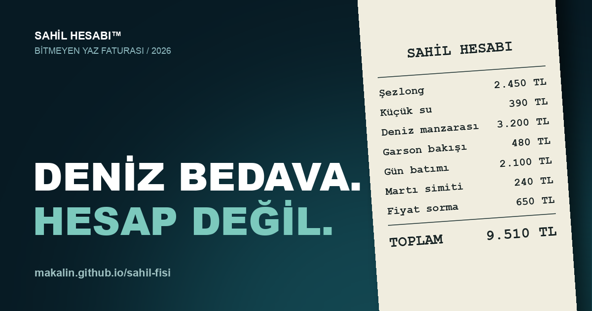

# 🧾 Sahil Fişi



### Tatil biter, hesap bitmez.

**Bir şezlong, iki kahve, üç su… ve hiç bitmeyen bir hesap.**

Sahil Fişi, Türkiye'nin sahil işletmelerindeki astronomik fiyatları sonsuza uzanan bir fiş animasyonuyla hicveden, açık kaynaklı interaktif bir web deneyimi.

Minimal tasarım. Maksimum hesap.

## ✨ Özellikler

- 🧾 Hiç bitmeyen tek bir fiş: kalemler, ara toplamlar, genel toplam
- 💸 60'tan fazla abartılı kalem: "Garsonun bakış ücreti", "Martıya kaptırılan simit", "Gün batımı (premium)"…
- 🎲 Sürpriz olaylar, komik indirimler ve fiş notları
- 📤 Tek tıkla paylaşım: telefonda sistem paylaşım menüsü, masaüstünde X, WhatsApp, Telegram, Facebook, LinkedIn, Bluesky; paylaşım metninde o anki toplam yazar
- ⚡ Animasyon hızı ve duraklatma kontrolü
- 📱 Mobil ve masaüstü uyumlu tasarım
- 🚀 Framework yok, bağımlılık yok. Sadece HTML, CSS ve JavaScript.

## 🚀 Çalıştır

```
git clone https://github.com/makalin/sahil-fisi.git
cd sahil-fisi
python3 -m http.server 8000
```

Tarayıcıdan `http://localhost:8000` adresini aç.

**🌊 Canlı:** [https://makalin.github.io/sahil-fisi/](https://makalin.github.io/sahil-fisi/)

## 🤝 Açık Kaynak

Katkılar, fikirler ve pull request'ler açık!

En kolay katkı: yeni bir komik kalem eklemek. `index.html` içindeki `menu` dizisine `['Kalem adı', enAz, enÇok, 'isteğe bağlı not']` satırı eklemen yeterli.

**Lisans:** MIT © 2026 Mehmet T. Akalın

**Geliştirici:** [Mehmet T. Akalın](https://github.com/makalin)

---

*Fiyatlar hiciv amaçlı kurgusal örneklerdir.*

**Sahil Fişi — Hesap uzar, tatil kısalır.**